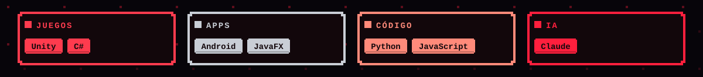

Desarrollador de aplicaciones. Me muevo entre videojuegos, móvil, escritorio y web, y me gusta llevar un proyecto desde la primera idea hasta algo que otra persona pueda instalar y usar.

## Qué hago

**Videojuegos con Unity.** Programo en C# la jugabilidad, la física, la interfaz y el guardado de partidas. También preparo builds para PC y Android.

**Apps Android.** Hago aplicaciones nativas en Java y Kotlin: pantallas, almacenamiento local, consumo de APIs y publicación en Google Play.

**Escritorio con JavaFX.** Hago aplicaciones de gestión con interfaces en FXML, conexión a base de datos y la arquitectura bien separada (MVC).

**Python.** Lo uso para scripts que me ahorran trabajo: tratar ficheros y datos, scraping, automatizar tareas repetitivas y prototipar rápido.

**Web.** JavaScript, HTML y CSS para páginas, paneles y herramientas pequeñas que corren en el navegador.

**IA aplicada.** Integro modelos de lenguaje (Claude, API de Anthropic) en aplicaciones reales: asistentes, generación y análisis de texto, y automatización de flujos de trabajo.

## Herramientas

## Ahora mismo

- Preparando mis primeros proyectos para publicarlos aquí.
- Profundizando en integrar IA dentro de apps móviles y juegos.

## Contacto

Si quieres hablar de un proyecto, proponerme algo o colaborar, escríbeme.

- **Correo:** [ivansal.cole@gmail.com](mailto:ivansal.cole@gmail.com)
- **GitHub:** [@ivansalcole](https://github.com/ivansalcole)
- **Issues:** [abre uno en este repositorio](https://github.com/ivansalcole/ivansalcole/issues)
